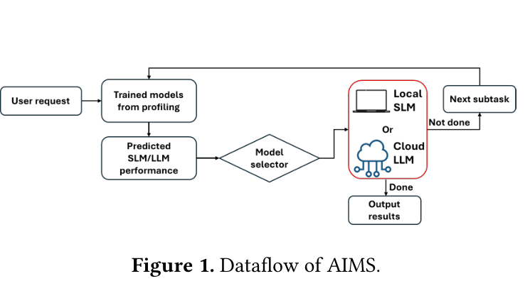
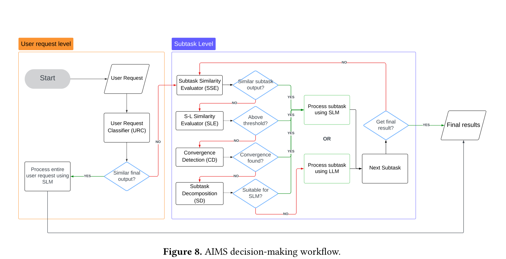
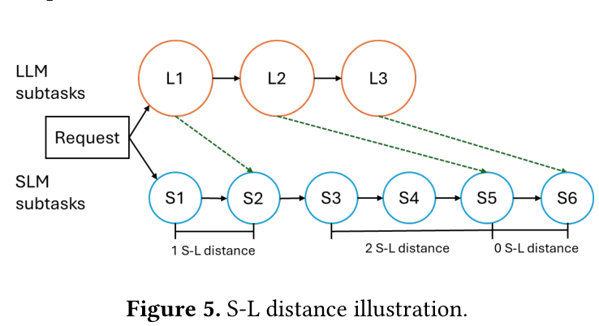
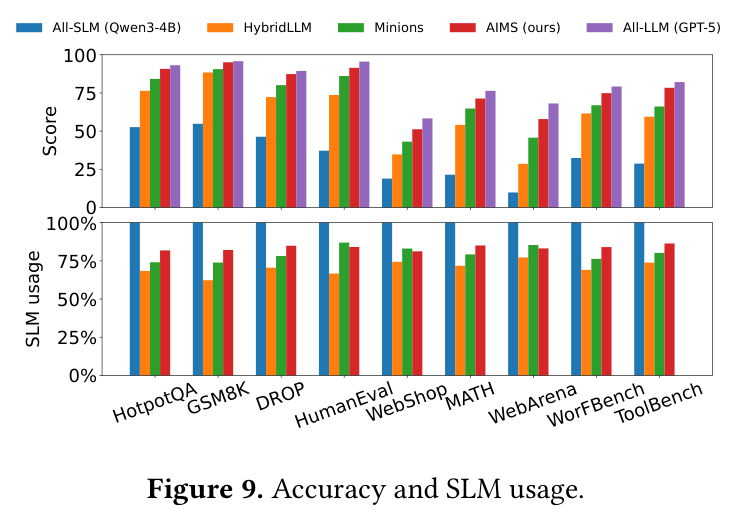

# AIMS: Cost-Efficient LLM-Based Agent Deployment in Hybrid Cloud-Edge Environments

| 项目 | 内容 |
|---|---|
| 作者 | Shiyi Liu、Haiying Shen、Shuai Che、Mahdi Ghandi、Mingqin Li |
| 单位 | University of Virginia、Microsoft、Shopify（Mingqin Li 在 Microsoft 任职期间完成本工作） |
| 发表 | EuroSys 2026，pp. 1862–1878 |
| 链接 | [正式论文](https://doi.org/10.1145/3767295.3803622) · [早期预印本 HERA](https://arxiv.org/abs/2504.00434) |
| 关键词 | 端云协同、智能体、迭代级路由、轨迹依赖、收敛检测 |
| 阅读日期 | 2026-11-13 |

> **一句话总结**：智能体每一步用小模型还是大模型，会改变后续任务的内容。AIMS 先用真实模型离线采集不同路由下的轨迹，再训练小型预测器，在线判断小模型能否直接完成、能否多走几步与大模型对齐、能否通过拆分完成，尽量减少云端调用。

**版本说明**：本文以 EuroSys 2026 正式版为准。早期预印本名为 HERA，不能直接混用其中的模型设置和实验数字。下面将论文报告、图中提取值和自己的理解分别注明；未进行代码复现。

## 1. 问题与动机

- **场景**：端侧运行 SLM，云端 API 提供 LLM。智能体通过连续的推理、工具调用和状态更新，动态生成下一子任务，直到完成用户请求。
- **痛点**：全部使用云端模型调用成本高；全部使用本地小模型又容易在多步任务中偏离正确轨迹。单独判断当前步骤是否简单，无法保证整条执行链成功。
- **关键区别**：普通单轮问答的路由只改变当前答案；智能体路由还会改变后续问题、工具参数和执行状态。

| 已有方法 | 怎么做的 | 在本文场景中的不足 |
|---|---|---|
| All-LLM | 每个步骤都交给云端大模型 | 准确率较高，但云端费用高 |
| All-SLM | 每个步骤都交给本地小模型 | 复杂推理和长链执行容易失败 |
| HybridLLM | 原本做请求级质量感知路由；本文将其用于逐子任务选择 | 独立判断每一步，难以建模选择对后续轨迹的影响 |
| Minions（本文实现） | 本地先尝试，再按不确定性升级到云端 | 本文的比较实现缺少 AIMS 的位置感知和轨迹收敛处理；不能直接等同于 Minions 原论文的全部协议 |

**本文要回答的问题**：当前这一步是否必须使用 LLM？如果小模型当前输出不同，它能否通过多走几步，或者把任务拆细，重新到达相近的状态？

## 2. 核心思路

AIMS 的全称是 Adaptive Iteration-level Model Selector。它先判断整个请求是否能由 SLM 完成；不能时，再进入逐子任务的级联决策。直接输出不相似，也不立即上云，而是继续检查“未来能否对齐”和“拆细以后能否完成”。


*图源：论文图 1，原图未修改。AIMS 负责选模型，选中的真实模型负责执行。*

论文的四个观察与设计之间有明确对应关系：

| 观察（§2） | 对应设计 |
|---|---|
| 独立路由每一步可能改变后续任务链 | 预测子任务轨迹，而非只看当前步骤 |
| 一些完整请求、一些局部步骤用 SLM 就足够 | 请求级分类器 URC、子任务相似度评估 SSE |
| 越靠后的步骤，模型切换对最终准确率的平均影响越大 | 随步骤序号提高相似度阈值 |
| SLM 可能需要更多步骤，才能到达与 LLM 相近的输出 | S-L 距离、SLE、收敛检测 CD、子任务分解 SD |

我的理解是：AIMS 把“当前结果不同”进一步分成“暂时不同但可以追回”和“持续偏离”两种情况，争取利用前一种情况节省云端调用。

## 3. 方法细节

### 3.1 离线画像：用真实模型收集分支轨迹

对每个训练请求，构建子任务二叉树。节点表示当前子任务，边表示选择 SLM 或 LLM 执行这个子任务。每个需要展开的节点分别使用两种真实模型，得到各自的后续子任务，再递归展开；达到预设深度（例如 15 步）或任务结束时停止（§3.3）。

```text
当前子任务及其执行上下文
├─ 真实 SLM 执行 → 后续子任务 A
│  ├─ 真实 SLM 执行 → ……
│  └─ 真实 LLM 执行 → ……
└─ 真实 LLM 执行 → 后续子任务 B
   ├─ 真实 SLM 执行 → ……
   └─ 真实 LLM 执行 → ……
```

**离线画像中的 LLM 是真实的大模型。** 先收集真实行为，再训练预测器；否则预测器缺少可以学习的对应输出。同一位置沿不同历史分支到达的子任务和上下文可能不同，不能把所有分支当成一组固定步骤的任意拼接。

需要区分三个阶段：

| 阶段 | 执行者 | 产物 |
|---|---|---|
| 离线采集 | 真实 SLM、真实 LLM | 不同模型选择产生的实际轨迹 |
| 在线决策 | 小型分类器、子任务预测器等 | 对两种模型未来行为的预测 |
| 在线执行 | 路由选中的真实 SLM 或 LLM | 当前步骤的实际结果 |

从数据中训练的模型包括：

| 模型 | 输入与学习目标 | 基座 |
|---|---|---|
| URC | 请求 → All-SLM 与 All-LLM 最终输出的相似度 | ModernBERT |
| 两个 SP | 当前子任务 → 分别由真实 SLM、LLM 生成的下一子任务 | Qwen3-0.6B + LoRA |
| DP | 子任务内容与序号 → S-L 距离 | ModernBERT |
| SD | 当前子任务及相关预测 → 更细的子子任务序列 | Qwen3-0.6B + LoRA |

特别是 $SP_{LLM}$，它是**学习预测 LLM 行为的小模型**，名字中的 LLM 表示预测对象。在线评估一个选择时，不需要先把真实云端 LLM 跑一遍再决定是否调用它。

### 3.2 在线级联：先整体，再局部，再寻找恢复机会


*图源：论文图 8，原图未修改。*

| 顺序 | 组件 | 判断什么 | 通过后怎么做 |
|---|---|---|---|
| 1 | URC：请求级分类 | 整个请求能否仅靠 SLM 得到相似结果 | 全请求使用 SLM |
| 2 | SSE：子任务相似度评估 | 两个 SP 预测的下一子任务是否相似 | 当前子任务使用 SLM |
| 3 | SLE：S-L 相似度评估 | 预测 SLM 多走若干步，能否与当前 LLM 进度匹配 | 按预测结果利用 SLM |
| 4 | CD：收敛检测 | 继续推演两条预测轨迹，未来是否存在对齐点 | 到收敛点之前使用 SLM |
| 5 | SD：子任务分解 | 拆出的每个子子任务是否都适合 SLM | 全部通过才用 SLM 执行整组；否则原任务上云 |

SLE 先通过 DP 估计距离，再检查相应位置；CD 则进一步迭代预测未来子任务。CD 若找到多个收敛点，论文选择最后一个，以提高 SLM 使用率。这里推演的是预测轨迹，预测误差也可能随前瞻深度累积。

**原文的一处实现歧义**：算法 1 第 8 行让 SLM 处理当前及后续 $d$ 个子任务，§3.2 和 §3.4.2 的相应文字只写把当前子任务分给 SLM。这会影响具体的控制流，复现时需要确认。

### 3.3 关键公式：相似度、位置与 S-L 距离

**相似度。** 论文用 SBERT 嵌入的余弦相似度衡量相关文本输出的接近程度（§2.1）：

$$
\operatorname{sim}(x,y)=\frac{e(x)^\top e(y)}{\lVert e(x)\rVert\,\lVert e(y)\rVert}.
$$

它衡量语义接近程度。语义相似可以作为路由依据，但不自动等价于代码正确、工具参数正确或任务最终成功。

**位置感知阈值。** SSE 使用经验确定的阈值（§3.4.2）：

$$
\kappa(ID)=0.6+0.02\min(ID,5).
$$

按 $ID=1,2,3,4,5$ 代入，阈值分别为 0.62、0.64、0.66、0.68、0.70，之后封顶。原文没有说明编号从 0 还是 1 开始，因此起始值存在歧义。

“后面更严格”的实验依据是单点替换：以 All-LLM 为基础，只把一个步骤换成 SLM，正文报告 Early、Middle、Late 阶段最终准确率分别下降 5.25、7.59、9.53（原文以 % 记述，图 4a）。这支持平均趋势，不能推出每个请求都是最后一步最重要。一个可能的解释是收尾错误缺少后续纠正机会；关键早期步骤也可能决定整条轨迹。

**S-L 距离。** 它表示 SLM 为达到与某个 LLM 子任务相似的输出，需要额外走多少步。图 5 中，L1 对应 S2，距离为 1；L2 对应 S5，距离为 2；L3 对应 S6，距离为 0。


*图源：论文图 5，原图未修改。它强调匹配过程中的额外步数，不是简单计算两个绝对下标之差。*

如果以 $m_k$ 表示与第 $k$ 个 LLM 步骤匹配的 SLM 位置，并令 $m_0=0$，图示可整理为：

$$
d_k=m_k-m_{k-1}-1.
$$

这是我对图 5 的记号整理，不是原文给出的通用定义式。对于无法匹配的情况，论文将距离设为无穷大。

### 3.4 优化目标与算法性质

论文的目标是在保持较高任务准确率的前提下，增加 SLM 使用、降低远程开销。它没有给出一个带显式费用预算、时延预算的在线约束优化求解器，也没有给近似比或竞争比。

我的理解是：这是一套由实验观察驱动、依赖学习预测器和经验阈值的调度方法。准确率保持是实验中的权衡结果，不能将“预测相似”读成严格的正确性保证。

## 4. 实验

**设置（§4.1、图 10、表 3）**：主要组合为端侧 Qwen3-4B 与云端 GPT-5；桌面端延迟在 RTX 5090 上测量。补充设置包括 Gemma3 + Claude Sonnet 4，以及 iPhone 15。九个基准为 HotpotQA、GSM8K、DROP、HumanEval、WebShop、MATH、WebArena、WorFBench、ToolBench。

估计器使用 WorFBench 与 GSM8K 生成的 1000 条子任务轨迹训练，在 A100 上微调约 2 小时。**这 2 小时是微调时间，不能直接当成包含真实模型调用的全部离线画像成本。** 九个测试基准中有两个来自训练所用数据集，另外七个用于考察跨数据集泛化；不能把九个基准的宏平均都称为分布外结果。

**主要结果**：下表准确率来自对图 9 柱高的提取并取九基准宏平均，约数；时延来自图 10 / §4.2，远程成本来自表 2。不同列有各自统计口径，不是同一原始结果表。

| 方法 | 图 9 宏平均准确率 | 平均时延（桌面） | 归一化远程成本 |
|---|---|---|---|
| All-SLM | 约 33.57% | 11.14 s | 0（仅按云端 API 费用） |
| HybridLLM | 约 61.01% | 12.98 s | 0.29 |
| Minions | 约 69.74% | 14.21 s | 0.20 |
| **AIMS** | **约 77.59%** | **13.33 s** | **0.17** |
| All-LLM | 约 81.99% | 15.82 s | 1.00 |


*图源：论文图 9，原图未修改。图中数值与正文个别数字有小幅差异，因此上表保留“约”。*

- AIMS 图 9 的平均 SLM 使用率约 83.66%；表 4 的完整系统为 83.58%，与摘要约 83.4% 接近。
- 远程成本由 1.00 降至 0.17，约节省 83%；相对 HybridLLM 的节省约为 $(0.29-0.17)/0.29=41.4\%$。这些结果只核算云端 API，未计端侧耗电、设备占用和传输成本。
- 相对 All-LLM，AIMS 的宏平均准确率低约 4.40 个百分点。WebArena 上差距约 10.2 个百分点（57.9% 对 68.1%），所以“相近准确率”需要结合具体任务判断。
- **并非每个基准上都最便宜**：HumanEval、WebShop、WebArena 上，表 2 的 Minions 远程成本低于 AIMS，但准确率也更低。

**消融（表 4）**：

| 变体 | 准确率 | SLM 使用率 |
|---|---|---|
| 完整 AIMS | 77.62% | 83.58% |
| 去掉 SD | 76.04% | 78.04% |
| URC + SSE + SLE（无 CD、SD） | 73.90% | 75.52% |
| URC + SSE | 72.48% | 72.36% |
| 仅 URC | 70.10% | 71.98% |
| 去掉 URC | 76.82% | 70.18% |

逐级消融中有些行同时缺少多个后级组件，不能把与完整系统的全部差值都归到某一个组件。单独去掉 URC 时，准确率下降 0.80 个百分点，SLM 使用率下降 13.40 个百分点，显示请求级筛选的主要收益是扩大本地执行比例。

**敏感性与硬件**：提高相似度阈值通常提高准确率、减少 SLM 使用（图 12）。在 iPhone 15 上，端到端时延达到 All-LLM 的 2.52 倍（表 3），说明桌面 GPU 上的延迟优势不能直接推广到手机。

- **我认为最有说服力的结果**：逐级加入轨迹相关组件后，准确率与 SLM 使用率同时上升。它支持“不能只孤立地看一步”的设计动机，但尚不能代替更严格的控制变量实验。
- **我认为最弱的结果**：固定路由策略迁移到手机后明显变慢；主结果缺少误差条或置信区间，且部分表图之间统计口径不一致。

## 5. 我的理解与疑问

1. **离线画像究竟要付出多少真实模型调用？** 深度为 $D$ 的完整二叉树有 $2^D$ 个叶节点；若按根深度 0、每条边一次模型执行计，边数为 $2^{D+1}-2$。这只是无提前终止、无合并时的结构性上界，不是论文实测调用量。真实树规模、剪枝、缓存、API 花费和完整画像耗时没有充分报告。能否给出成本摊销所需的请求量？

2. **“预测结果相似”足以判断真实执行安全吗？** 两个预测器可能一起预测错误；很像的工具调用也可能只差一个关键参数。能否用执行状态、工具校验和风险校准补充纯语义相似度？

3. **CD 的多步预测误差如何积累？** 原文只说向前预测预设数量的步骤，没有充分交代前瞻深度和误差随深度的变化。选择最后一个收敛点增加 SLM 使用，是否也放大了预测失误的后果？

4. **后期更重要是否能由序号充分表示？** 论文展示平均位置效应，但关键的检索、实体选择或规划也可能出现在开头。能否学习步骤的实际影响，而不是只使用序号线性提高阈值？原文也未清楚交代 $ID$ 的编号起点，以及固定阈值敏感性实验与自适应 $\kappa$ 的具体关系。

5. **手机上的 2.52 倍时延，为什么没有改变路由？** 表 3 固定路由策略、只改变设备，因而展示了硬件影响，却没有完成硬件感知的调度。是否应该把设备吞吐、排队、网络 RTT 和剩余电量一起作为路由输入？

6. **实验数字如何统一？** 图 9 提取出的 AIMS 对 HybridLLM / Minions 的宏平均准确率差约为 16.58 / 7.85 个百分点，表 3 同一模型组合却为 12.35 / 6.86。摘要的 27.5% 也不能直接读成提高 27.5 个百分点。原文没有充分解释这些口径差异，复现时需要原始逐请求结果。

7. **论文与代码是否一致？** 本次未取得并核验对应正式版实现，因此暂不能回答。特别需要检查二叉树采集是否保留完整上下文、SLE 的执行范围、CD 的前瞻深度、表 5 中 CD 的模型来源，以及持续微调如何获得没有实际执行的另一分支标签。

## 6. 与相关工作的关系

| 工作 | 关系与区别 |
|---|---|
| HybridLLM | 请求级质量感知路由是基础；AIMS 将选择深入到动态迭代，并处理后续轨迹 |
| Minions | 同属端云小大模型协作；AIMS 重点是迭代级路由和预测收敛，比较时需要核查基线改编方式 |
| HybridFlow | 都做子任务级端云选择；HybridFlow 侧重 DAG 并行、效用预测与资源预算，AIMS 侧重动态序列、位置与轨迹对齐 |
| Division-of-Thoughts | 都涉及子任务分解和端云协同；AIMS 主实验未把它列为基线，不能据此判断谁更好 |
| vLLM / PagedAttention | 推理服务层优化，与上层选模型互补；AIMS 没有解决底层批处理和 KV 缓存管理 |

**一句话定位**：相对“这一题或这一步该用谁”，AIMS 多问了“这次选择会把后续轨迹带到哪里”。

## 7. 可以继续想的方向

- **能否减少离线分支采样？** 完整探索昂贵 → 优先采样两模型分歧大、下游风险高的节点，复用已画像模型的信息 → 需要报告标签质量、画像成本和最终路由收益，而不只比较预测器准确率。
- **能否把轨迹风险和资源预算联合建模？** 当前阈值主要依赖位置 → 将剩余时延、费用、设备速度与成功风险一起输入策略 → 需要可靠的代价估计，并与 AIMS、固定预算路由分别比较。
- **能否只在必要时进行深度预测？** CD 的前瞻可能收益递减 → 按不确定性或预期收益决定继续预测还是立即上云 → 需要测量预测开销、误差传播和决策价值。
- **多用户共享边缘资源时如何调度？** 单请求中本地执行更省 API，不代表多请求并发时总时延更低 → 引入队列和工作流状态，联合决定执行位置与服务顺序 → 需要真实并发负载和端到端指标。
- **从算法角度能否给出有条件的保证？** 可以先限定有限状态、已知转移和有界误差，再研究带预算的序列决策或约束 MDP。不能直接把会改变后续状态的步骤当成独立背包物品；也不能在没有额外假设时宣称近似比。

## 8. 术语速查

| 术语 | 我的理解 |
|---|---|
| 子任务 / 迭代 | 智能体推进请求的一步，后续步骤可随结果改变 |
| 离线画像 profiling | 真实运行模型、收集不同选择的行为和结果，作为训练依据 |
| URC | 先判断整个请求是否可以全部留在本地 |
| SP | 预测某种模型将生成的下一子任务；预测器本身不是被预测的大模型 |
| SSE | 比较两种模型预测的下一子任务是否接近 |
| S-L 距离 | 小模型到达对应大模型进度所需的额外步骤 |
| SLE | 根据预测距离检查是否能对齐 |
| CD | 向前推演，寻找两条预测轨迹的收敛点 |
| SD | 把复杂步骤拆细，整组都通过评估后交给小模型 |
| 宏平均 | 先在每个数据集算指标，再对数据集等权平均 |
| 百分点 / 相对提升 | 77% 对 61% 是增加 16 个百分点，相对提升约 26.2%，二者不同 |

## 9. 引用

```bibtex
@inproceedings{liu2026aims,
  title     = {AIMS: Cost-Efficient LLM-Based Agent Deployment in Hybrid Cloud-Edge Environments},
  author    = {Liu, Shiyi and Shen, Haiying and Che, Shuai and Ghandi, Mahdi and Li, Mingqin},
  booktitle = {Proceedings of the 21st European Conference on Computer Systems},
  pages     = {1862--1878},
  year      = {2026},
  doi       = {10.1145/3767295.3803622}
}
```

来源：[AIMS 正式论文](https://doi.org/10.1145/3767295.3803622)，重点为 §2、§3.3–3.4、§4 和 §5。相关对照：[HybridLLM](https://arxiv.org/abs/2404.14618)、[Minions](https://arxiv.org/abs/2502.15964)、[HybridFlow](https://arxiv.org/abs/2512.22137)。

论文图 1、5、8、9 依原文的 [CC BY 4.0](https://creativecommons.org/licenses/by/4.0/) 许可引用，作者和出处见上，原图未修改。解释、表格整理和批判性问题属于个人阅读笔记。
